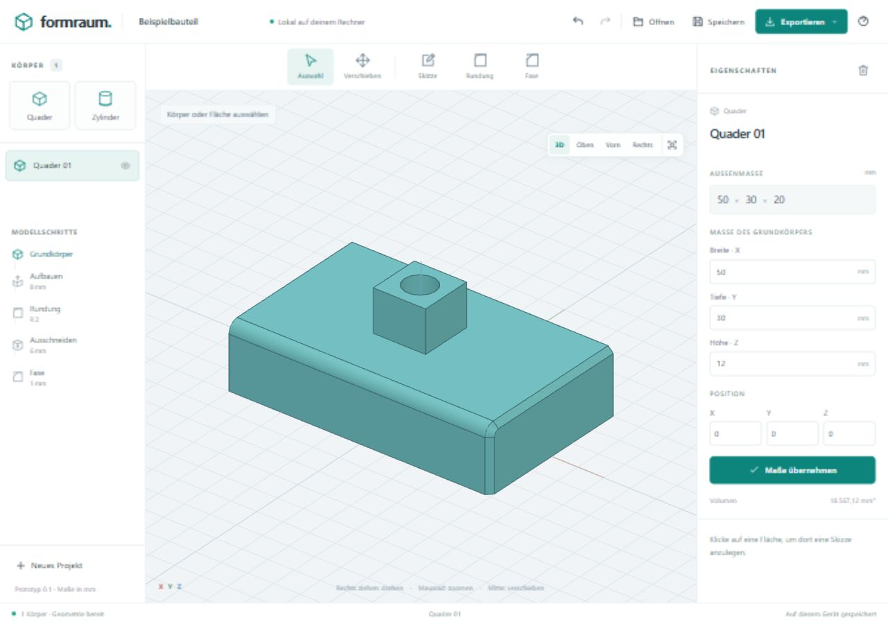

# Formraum · CAD im Browser

**[Formraum direkt im Browser öffnen](https://kami-00.github.io/formraum/)**

Formraum läuft vollständig im Browser: Oberfläche, echte CAD-Volumenkörper, STEP-Import und STEP-/STL-Export. FreeCAD, Python und ein CAD-Backend werden nicht benötigt. Open CASCADE wird als WebAssembly in einem Web Worker ausgeführt; Projekt- und Modelldaten bleiben auf deinem Gerät. Alle Maße sind in Millimetern.



## Anwendung öffnen

Die gebaute Anwendung wird als statische Website über HTTPS bereitgestellt. Nutzer öffnen nur deren Adresse – keine Installation, kein npm und kein lokaler Server erforderlich. Nach dem ersten vollständigen Laden speichert ein Service Worker auch den CAD-Kern für die Offline-Nutzung. Browser können diesen Cache bei Platzmangel entfernen; Projektdateien deshalb regelmäßig herunterladen.

Der erste Aufruf lädt rund 23 MB WebAssembly (bei gzip etwa 7,3 MB). Aktuelle Desktop-Browser mit WebAssembly, WebGL und Web Workers werden benötigt. Automatisiert geprüft wird Chromium. Maus und Tastatur sind für die CAD-Bedienung vorgesehen.

### Lokal entwickeln

Node.js **22.12 oder neuer** installieren und im Projektverzeichnis ausführen:

```sh
npm ci
npm run dev
```

Die ausgegebene Adresse öffnen (normalerweise `http://127.0.0.1:5173`). Unter Windows erledigt `start.cmd` diese Schritte und öffnet den Browser. Node.js dient ausschließlich der Entwicklung und dem Erstellen der statischen Dateien. Der lokale Entwicklungsserver liefert Dateien; er berechnet keine Geometrie.

### Statische Website bereitstellen

```sh
npm ci
npm run build
npm run preview
```

Den vollständigen Inhalt von `dist/` auf einem beliebigen statischen HTTPS-Host veröffentlichen. Auch Unterverzeichnisse wie `/formraum/` funktionieren; es werden relative Asset-Pfade verwendet. `.wasm` sollte mit `application/wasm` und möglichst komprimiert ausgeliefert werden. Keine API, Datenbank, Serverfunktion oder besonderen Cross-Origin-Isolation-Header nötig. Das direkte Öffnen von `index.html` über `file://` wird wegen Browserbeschränkungen für Module und Worker nicht unterstützt.

Für **GitHub Pages** ist `.github/workflows/pages.yml` vorbereitet: In den Repository-Einstellungen unter **Pages → Source → GitHub Actions** auswählen. Nach Übernahme auf `main` baut, testet und veröffentlicht der Workflow die Anwendung. Die vorgesehene Adresse ist `https://kami-00.github.io/formraum/`; sie ist erst nach erfolgreichem Deployment verfügbar. Das Einrichten dieses Workflows allein aktiviert Pages noch nicht.

## Mehrere Projekte im Browser

Über **Projekte** öffnest du die Projektverwaltung. Projekte lassen sich anlegen, umbenennen (Name oben), duplizieren und wechseln. Nicht aktive Projekte lassen sich nach Bestätigung löschen. Jedes Modell wird separat in `localStorage` gespeichert; die letzte Auswahl wird beim nächsten Start geöffnet. Die bisherige Einzelprojekt-Sicherung wird automatisch übernommen und als Sicherung unverändert behalten.

**Öffnen** importiert Projekt- und STEP-Dateien als neues Projekt. **Speichern** lädt eine zusätzliche Projektdatei herunter. Browser-Speicher ist begrenzt und gehört zum jeweiligen Browserprofil und zur Website-Adresse; regelmäßig Dateien sichern. Speicherfehler oder Änderungen in einem anderen Tab werden sichtbar gemeldet und überschreiben nicht stillschweigend den vorherigen Stand. Rückgängig/Wiederholen bezieht sich auf die aktuelle Bearbeitungssitzung und wird beim Projektwechsel zurückgesetzt.

Offene **Skizzenentwürfe** werden mit ihren Konturen, Maßen, Festlegungen und der ursprünglichen Modellversion separat im Browser gesichert. Nach einem Neuladen kannst du weiterzeichnen; **Speichern** nimmt den Entwurf auch in die Projektdatei auf. Unter **Projekte → Skizzenentwürfe** lassen sich weitere Sicherungen öffnen. Hat sich das Modell inzwischen geändert, wird der ursprüngliche Stand als eigenes Projekt wiederhergestellt. Entwürfe anderer Tabs und ältere Sicherungen werden dabei erhalten. **Skizze verwerfen** beendet den aktiven Entwurf ausdrücklich; bei einem Speicherfehler bleibt die Skizze ansonsten zum Sichern als Datei geöffnet.

Ein beschädigter Projekteintrag blockiert die übrigen Projekte nicht. Unter **Projekte → Beschädigte Sicherungen** lassen sich seine unveränderten Rohdaten herunterladen. Während einer offenen Skizze sind andere Modelländerungen gesperrt, damit deren Bezugsfläche erhalten bleibt.

## Gemeinsam mit einer KI arbeiten

Über **KI verbinden** kann jeder Nutzer einen lokalen MCP-Client mit dem geöffneten Tab koppeln. Die optionale Node.js-Brücke stellt acht MCP-Werkzeuge bereit: Projekte auflisten/öffnen/anlegen, aktives Modell und Ansicht lesen, geprüfte Änderungen vornehmen und rückgängig machen. Sitzungscode, explizites Verbinden und Revisionsprüfung verhindern Zugriff ohne Kopplung und veraltete Schreibversuche. Die reine Browser-Anwendung braucht weiterhin keine Installation.

Die [MCP-Anleitung](docs/MCP.md) enthält die Einrichtung für Codex und andere lokale STDIO-Clients, Verbindungsschritte und Grenzen. Erst nach dem Koppeln kann der MCP-Client Modelldaten lesen und gegebenenfalls an seinen KI-Anbieter senden.

## Arbeiten am Modell

1. **Körper wählen:** Quader, Zylinder, Kugel, Kegel/Kegelstumpf, Rohr, Ring, Keil, Pyramide, Vieleck-Prisma oder Kapsel hinzufügen. Maße, Position, Drehung (X → Y → Z) und gleichmäßige Skalierung rechts bearbeiten. Duplizieren und Auf Boden erleichtern das Platzieren.
2. **Skizze anlegen:** Eine ebene Fläche anklicken und **Skizze** aktivieren, oder **Skizze auf Grundebene** für einen eigenen Körper. Rechteck, Kreis, Ellipse oder regelmäßiges Vieleck zeichnen. Maße direkt an der Kontur anklicken oder rechts eingeben. Eingegebene Konturmaße werden beim Zeichnen festgehalten; das Häkchen löst die Festlegung. Mittelpunkt, Winkel, Polygonseiten und Fangraster sind einstellbar.
3. **Bearbeiten:** Höhe beziehungsweise Tiefe angeben. Die **Live-Vorschau** zeigt das berechnete Ergebnis für **Aufbauen** oder **Ausschneiden**, auch mit mehreren Konturen und **Durch alles**. Über **3D ansehen** lässt sich die Tiefe kontrollieren und die Ansicht mit der rechten Maustaste drehen; **Zur Skizzenansicht** kehrt zur Zeichenebene zurück. Erst die Schaltfläche **Aufbauen** beziehungsweise **Ausschneiden** unterhalb der Vorschau übernimmt die Änderung ins Modell. Ungültige Geometrie wird gemeldet und erhält das bisherige Modell. Die Vorschau lässt sich ausschalten; sie verwendet einen eigenen, bei Bedarf gestarteten CAD-Worker.
4. **Kanten bearbeiten:** **Rundung** oder **Fase** wählen, Kanten anklicken und Radius beziehungsweise Fasenmaß eingeben.
5. **Kombinieren:** Mehrere Körper per Häkchen oder Umschalt-Klick auswählen. Ausrichten bezieht sich auf den zuerst ausgewählten Körper. Vereinen, Von Basis abziehen und Schnittmenge verbinden Formen. **Gruppieren** vereint feste Körper und zieht als **Bohrung** markierte Körper ab. Ausgangsformen bleiben in der Kombination gespeichert; ihre Grundmaße und Positionen lassen sich dort bearbeiten. Ohne weitere Modellschritte lässt sich die Kombination auflösen. Alle Ergebnisse müssen zusammenhängend sein. Bohrkörper allein erscheinen nicht im Export.
6. **Sichern:** **Speichern** lädt eine bearbeitbare `.formraum.json`-Datei herunter. **Exportieren** erzeugt STEP für andere CAD-Systeme oder STL für den 3D-Druck. **Öffnen** unterstützt Projektdateien und STEP (`.step`, `.stp`).

### Mehrere Konturen, Bohrungen und Kantenmaße

In einer Skizze lassen sich über **+ Kontur** bis zu zwölf Konturen anlegen, auswählen, kopieren und entfernen. Jede Kontur hat eigene Größe, Winkel und Position; die aktive Kontur zeigt ihre anklickbaren Maße. **Normale Kontur** trägt zum gemeinsamen Aufbau-/Schneidwerkzeug bei. **Aussparung** entfernt ihren Bereich daraus und muss eine normale Kontur überlappen. Mehrere Bohrungen erzeugst du mit normalen Kreisen und anschließend **Ausschneiden**, optional **Durch alles**. Für eine Platte mit Loch zeichnest du ein normales Rechteck und darin einen Kreis als Aussparung; anschließend **Aufbauen**. Alle Konturen teilen sich dieselbe Tiefe. Eigenständige Skizzenkörper müssen zusammenhängend sein.

Unter **Position festlegen** wählst du horizontal links/rechts oder vertikal unten/oben und trägst den Abstand ein. **Abstand bis** unterscheidet Konturrand und Mittelpunkt, beispielsweise die Achse einer Bohrung. Die Bezüge gelten in der Skizzenansicht. Die ausgewählten Außenkanten werden markiert; Abstandsmaße erscheinen an der Kontur. **Zentriert** hält eine Achse mittig; **Auf Fläche zentrieren** richtet beide Achsen aus. **Position freigeben** löst die Bezüge und erhält die aktuelle Position.

Die Abstände werden bei Änderungen der Konturgröße, des Winkels oder der Bezugsfläche neu berechnet und mit dem Projekt gespeichert. Auch nach dem Aufbau kannst du im Modellschritt unter **Kontur bearbeiten** jede Kontur samt Maßen und Abständen ändern. Kantenbezüge sind zunächst auf rechteckige Außenkonturen begrenzt, deren Kanten in den lokalen U/V-Richtungen liegen; innere Löcher werden nicht als Bezugskanten verwendet. Bei gedrehten oder skalierten Körpern folgen die Bezüge dem Körper. Ungültige oder nicht eindeutig zuordenbare Bezüge werden abgewiesen, statt an eine andere Kante zu springen. Freie Linien, beliebige schräge/gerundete Bezugskanten und Abstandsabhängigkeiten zwischen zwei Konturen sind noch nicht enthalten.

Ein vollständiges Beispiel mit vier bemaßten Durchgangsbohrungen liegt in `examples/Platte-mit-vier-Bohrungen.formraum.json`.

Rechts ziehen dreht, das Mausrad zoomt, die mittlere Maustaste verschiebt die Ansicht. **F** passt das Modell ein. **Strg Z** macht einen Schritt rückgängig, **Strg Y** stellt ihn wieder her. Unter macOS funktioniert auch Cmd. **Oben**, **Vorn** und **Rechts** helfen beim Zeichnen.

`examples/Beispielbauteil.formraum.json` enthält Aufbau, Kreistasche, Rundung und Fase; die passenden STEP-/STL-Dateien liegen daneben. Das vorhandene Projektformat Version 1 bleibt erhalten. Ebene Flächen werden über ihre Außenkontur, Lage und Normale zugeordnet; innere Bohrungen verschieben ihren Skizzenursprung nicht. Kantenbezüge werden über Geometrie und Endpunkte geprüft. Änderungen der Open-CASCADE-Reihenfolge werden eindeutig zugeordnet. Nicht eindeutig zuordenbare Bezüge werden abgewiesen; die letzte gültige Geometrie bleibt erhalten. Alte Bezüge werden beim erfolgreichen Laden unter Erhalt der Konturpositionen aktualisiert. Bereits inkonsistente alte Referenzen ohne Außenkontur-Daten lassen sich nicht sicher automatisch rekonstruieren.

## Daten und Grenzen

Die automatischen Projektsicherungen liegen im lokalen Browser-Speicher der jeweiligen Website-Adresse. Sie ersetzen keine heruntergeladenen Projektdateien. Es gibt keine Cloud-Synchronisierung, Telemetrie oder extern geladenen Laufzeitbibliotheken. Die optionale MCP-Verbindung ist davon getrennt. Der CAD-Kern und seine Abhängigkeiten werden zusammen mit der Anwendung ausgeliefert.

Unterstützt werden zehn Grundformen, vier Skizzenprofile, direkte Maßfelder, bis zu zwölf Konturen pro Skizze, Aussparungen, Durchgangsbohrungen, Kantenabstände und Zentrierbezüge auf rechteckigen Flächen, Konturmaße festhalten, Position/Winkel, Aufbauen, Ausschneiden, Körperkombinationen, Ausrichten, Rundung, Fase und STEP-Volumenkörper. Skizzenmaße und Bearbeitungstiefen bleiben nach dem Aufbau über die Modellschritte editierbar, auch bei skalierten Körpern. Dies ist ein erster Ausbau zum Übergang von einfachem Formenbauen zu parametrischem CAD, keine vollständige Tinkercad-/Onshape-Funktionsgleichheit. Freie Linienzüge, vollständig bemaßte Skizzen mit Abhängigkeiten und Baugruppenmechanik sind noch nicht umgesetzt. Jede Bearbeitung muss einen einzelnen gültigen Volumenkörper ergeben. Pro Projekt sind bis zu 30 Körper mit jeweils 50 Bearbeitungen vorgesehen; Kombinationen sind auf acht Verschachtelungsebenen und insgesamt 150 Ausgangskörper begrenzt; Dateiimporte sind auf 25 MB begrenzt. Komplexe Modelle hängen von Arbeitsspeicher und Leistung des Geräts ab. Nach 120 Sekunden wird eine hängende Berechnung abgebrochen; der Worker startet bei der nächsten Anfrage neu.

Neue Website-Versionen werden über **Neue Version · Neu laden** angeboten, sobald der Offline-Cache bereit ist. Beim Wechsel von älteren Versionen ohne diesen Hinweis alle Formraum-Tabs schließen und die Seite erneut öffnen; gespeicherte Projekte bleiben erhalten.

## Weiterer CAD-Ausbau

Beide Arbeitsweisen bleiben gleich wichtig: direktes Formenbauen und präzises Konstruieren. Die [Ausbauliste](docs/CAD-AUSBAU.md) trennt vorhandene Funktionen von offenen Grundlagen und Ausbauschritten. Als nächstes fehlen insbesondere freie Linien/Bögen, ein geometrischer Constraint-Solver (Koinzidenz, Parallelität, Tangentialität und Abstandsmaße zwischen Elementen), assoziative Feature-Muster, Rotationskörper aus eigenen Skizzen und Loft/Sweep. Baugruppen und Zeichnungsableitung benötigen darauf aufbauende eigene Werkzeuge. Diese Funktionen sind noch nicht enthalten.

### Kopieren, Spiegeln, Verschieben und Messen

- **Kopieren → Lineare Kopien:** Einen oder mehrere Körper auswählen, Anzahl einschließlich Original sowie X-/Y-/Z-Abstand pro Kopie eingeben. Negative Abstände kehren die Richtung um.
- **Kopieren → Kreiskopien:** Weltachse, Drehzentrum, Gesamtwinkel und Anzahl einstellen. Bei 360° wird die letzte Position nicht doppelt belegt. Ein Teilkreis enthält beide Winkelgrenzen. **Körper mitdrehen** legt fest, ob sich auch ihre Orientierung ändert.
- **Kopieren → Spiegeln:** X-, Y- oder Z-Normale und Position der Spiegelebene wählen. Beispielsweise spiegelt X mit Position 0 an der YZ-Ebene. **Original behalten** erzeugt einen zusätzlichen Körper; ausgeschaltet ersetzt die Spiegelung die Auswahl. Die Spiegelquelle wird als unabhängiger Stand mitgespeichert. Spiegelebene und Grundmaße einer einfachen Quelle bleiben im Eigenschaftenfenster änderbar; weitere Skizzen und Bearbeitungen auf dem gespiegelten Körper sind möglich.
- **Verschieben:** Eine Ebene (XY/XZ/YZ), optional nur eine ihrer Achsen und ein Raster wählen. Ziehen an einem ausgewählten Körper bewegt die ganze Auswahl und erhält ihre Abstände. Raster 0 oder Alt bewegt frei; Esc verwirft die laufende Bewegung. Zum Bewegen in Z XZ oder YZ wählen und die Ansicht entsprechend drehen.
- **Messen:** Außenmaße in Weltachsen, Oberfläche und Volumen der Auswahl anzeigen. Bei genau zwei Körpern **Kleinsten Abstand berechnen** wählen. Der CAD-Kern berücksichtigt auch gekrümmte Flächen; die Messung verändert weder Projekt noch Undo-Historie. Abstand 0 steht für Berührung oder Überlappung und ist keine Überdeckungstiefe.

Kopieraktionen bilden jeweils einen Undo-Schritt. Die neuen Körper sind unabhängige Kopien: Änderungen am Original werden nicht automatisch übertragen. Assoziative Körper-/Feature-Muster, freie Spiegelebenen, Punkt-/Kantenmessung und Kollisionsprüfung sind weitere Ausbauschritte. Die Grenze von 30 Körpern gilt auch für Kopien.

## Prüfungen

```sh
npm ci
npx playwright install chromium
npm run build
npm test
```

Die Tests führen den tatsächlichen WebAssembly-Kern im Browser aus. Sie prüfen Volumina, Flächen-/Kantenzuordnung, Aufbauen/Ausschneiden, Rundung/Fase, unveränderte Daten nach fehlgeschlagenen Operationen, das bestehende Beispielprojekt, STEP-Rückimport, binäres STL, Speichern, Rückgängig/Wiederholen und Wiederherstellung. Ein eigener Test lädt den Produktionsbuild von einem rein statischen Host unter `/formraum/`, schaltet das Netzwerk aus, lädt neu und modelliert/exportiert offline. Zusätzliche Tests prüfen Projektverwaltung, Migration, Speicherkonflikte, Speicherplatzfehler und die vollständige MCP-Verbindung über STDIO einschließlich Revisionen, Rückgängig, Ansichtsbild, Origin-/Code-Prüfung und einer HTTPS-Browser-Origin. Weitere Tests prüfen die analytischen Volumina aller Grundformen, Bohrkörper-Export, boolesche Operationen, gedrehte/skaliert referenzierte Skizzen, Maßfestlegung beim Zeichnen, ungültige Maße, parametrierte Vielecke und das Auflösen transformierter Kombinationen. Weitere Skizzentests prüfen Kantenabstände bei Größenänderungen, Mittelpunkt- und Konturbezüge, mehrere Bohrungen/Aussparungen, Konturwechsel, nachträgliche Maßänderungen sowie Durch-alles-Bohrungen bei geänderter Bauteildicke. CI führt dieselben Prüfungen aus.

`backend.py`, `backendqa.py` und `backend_reference_qa.py` bleiben als historische FreeCAD-Referenz erhalten. Sie gehören nicht zur Browser-Anwendung und werden weder gestartet noch ausgeliefert.

## Abhängigkeiten

- [Replicad](https://github.com/sgenoud/replicad): JavaScript-Schnittstelle zum CAD-Kern (MIT; siehe mitgelieferte Lizenz).
- [replicad-opencascadejs](https://github.com/sgenoud/replicad/tree/main/packages/replicad-opencascadejs): Open CASCADE als WebAssembly (LGPL-2.1; Originalquellen und Build-Anweisungen im verlinkten Projekt). Die WASM-Datei bleibt als austauschbare separate Datei erhalten.
- [Three.js](https://github.com/mrdoob/three.js): Darstellung und Kamerasteuerung (MIT).

Lizenztexte sind unter `web/public/licenses/` enthalten und über die Hilfe der Anwendung erreichbar. Versionen sind in `package-lock.json` festgeschrieben.

### Mechanische Formen, Wandung und Zeichenhilfen (0.5)

- **Zahnrad** unter Weitere Formen: Modul, 18–80 Zähne, Höhe und Bohrung. Geradverzahnung mit 20° Druckwinkel und polygonal angenäherten Evolventenflanken; vereinfachter Zahnfuß, keine normgeprüfte Verzahnung. Die Grundmaße folgen der [KHK-Referenz](https://khkgears.net/gear-knowledge/gear-technical-reference/calculation-gear-dimensions/).
- **Gewindestange**: Nenndurchmesser, Steigung und Höhe, maximal 24 Windungen. Echtes Rechtsgewinde als CAD-Geometrie mit vereinfachtem Profil, kein normgeprüftes ISO-Gewinde. Für Innengewinde eine passende Gewindestange durch den Grundkörper positionieren, als Bohrung markieren und beide gruppieren. Spiel über den Durchmesser des Schneidkörpers einstellen.
- **Hull**: mehrere Körper auswählen und **Hull · konvexe Hülle** wählen. Verbindet auch getrennte Körper. Die konvexe Hülle wird aus triangulierten Oberflächen berechnet; Rundungen werden facettiert angenähert, nicht analytisch umhüllt. Maximal 6000 Stützpunkte / 2500 Hüllflächen. Ausgangskörper bleiben bearbeitbar.
- **Wandung**: eine Fläche auswählen, Wandstärke eingeben und **Wandung anwenden**. Die gewählte Fläche wird entfernt, die übrigen Wände nach innen versetzt. **Geschlossen aushöhlen** erzeugt stattdessen einen geschlossenen inneren Hohlraum. Wandstärke später im Modellverlauf ändern. Geometrisch unmögliche Wandungen werden abgewiesen; das gespeicherte Modell bleibt erhalten.
- **Zeichenhilfen**: beim Aufziehen werden Ursprung, rechteckige Außenkanten, Flächenmitten und Mittelpunkte anderer Konturen gefangen. Orange Hilfslinien zeigen die Ausrichtung. Nahezu quadratische Rechtecke / kreisförmige Ellipsen und gleiche Radien werden beim Aufziehen vorgeschlagen. **Alt** unterdrückt Fanghilfen und Raster. Dies sind vorübergehende Zeichenhilfen, kein vollständiger SolidWorks-Constraint-Solver; dauerhafte Maße und Kantenbezüge werden weiterhin ausdrücklich gesetzt.
